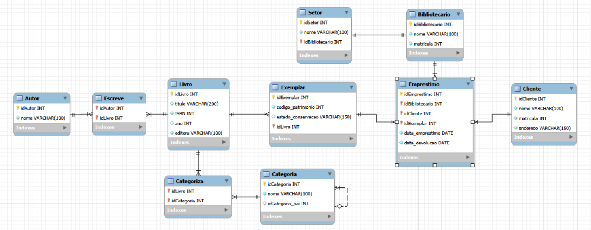
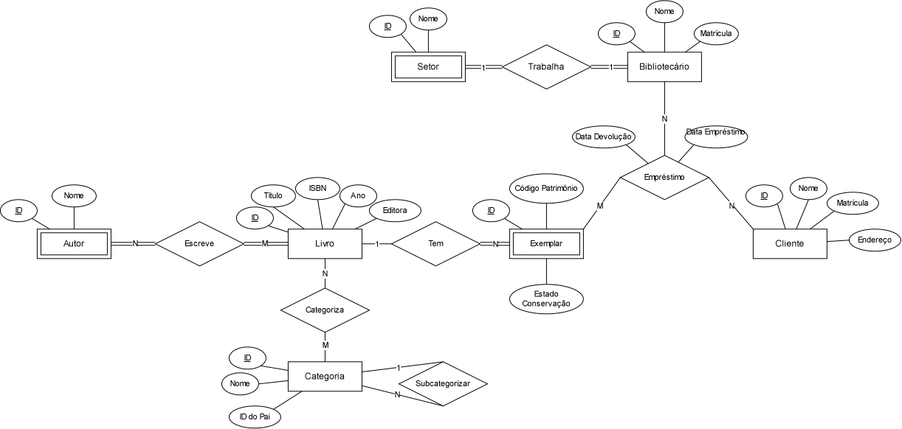

# **Biblioteca de Alexandria**

Projeto acadêmico da disciplina de Banco de Dados 1, com objetivo de modelar e implementar o banco de dados de uma biblioteca, contemplando entidades, relacionamentos e regras de negócio básicas de um sistema de empréstimos.
- Grupo: Gabriel Costa Aparecida, Marcelo Rodrigues Rosa Paschoal, Tiago Da Silva Machado.

## Sumário

1. [Descrição](#descrição)
2. [Entidades](#entidades)
3. [Relacionamentos](#relacionamentos)
4. [Entrega 1 - Requisitos Atendidos](#entrega-1---requisitos-atendidos)
5. [Diagrama Entidade-Relacionamento (DER)](#diagrama-entidade-de-relacionamento-der)
6. [Entrega 2 - Implementação](#entrega-2---implementação)
   - [6.1 Criação das tabelas (DDL)](#61-criação-das-tabelas-ddl)
   - [6.2 Inserção de dados (DML)](#62-inserção-de-dados-dml)
   - [6.3 Function](#63-function)
   - [6.4 Procedure](#64-procedure)
   - [6.5 Triggers](#65-triggers)
   - [6.6 Views](#66-views)
   - [6.7 Comandos DML (UPDATE, INSERT e DELETE)](#67-comandos-dml-update-insert-e-delete)
   - [6.8 Implementações extras](#68-implementações-extras)
   - [6.9 Usuários e ROLE](#69-usuários-e-role)
   - [6.10 Buscas com JOIN](#610-buscas-com-join)
7. [Situação da entrega](#situação-da-entrega)

## Descrição:

O sistema permite gerenciar livros, exemplares físicos, clientes, bibliotecários, categorias, autores e empréstimos, cobrindo os principais tipos de relacionamento entre entidades (1:1, 1:N, N:N, recursivo e associativo/ternário).

## Entidades:

| Nome | Descrição | Atributos |
|------|-----------|-----------|
| **Livro** | informações gerais da obra | idLivro, titulo, ISBN, ano, editora |
| **Exemplar** | cópia física de um livro | idExemplar, idLivro, codigo_patrimonio, estado_conservacao, disponivel |
| **Autor** | autor(es) das obras | idAutor, nome |
| **Cliente** | usuário que realiza empréstimos | idCliente, nome, matricula, endereco |
| **Bibliotecário** | funcionário responsável pelo atendimento | idBibliotecario, nome, matricula |
| **Setor** | separações organizacional da biblioteca | idSetor, nome, idBibliotecario |
| **Categoria** | classificação temática dos livros | idCategoria, nome, idCategoria_pai |
| **Empréstimo** | registro de retirada/devolução | idEmprestimo, idCliente, idExemplar, idBibliotecario, data_emprestimo, data_devolucao |

## Relacionamentos:
 
| Tipo | Entidades envolvidas | Descrição |
|------|----------------------|-----------|
| 1:1 | Bibliotecário - Setor | Bibliotecário trabalha em um setor e um setor é trabalhado por um bibliotecário |
| 1:N | Livro - Exemplar | Existem vários exemplares de um livro, porém um exemplar só pode representar um livro |
| N:N | Livro - Categoria | Um livro pode ter várias categorias e uma categoria pode pertencer vários livros |
| N:N | Livro - Autor | Um livro precisa de pelo menos um autor e um autor precisa ter escrito pelo menos um livro |
| Recursivo | Categoria - Categoria (subcategorias) | Uma subcategoria pode estar dentro de uma categoria Ex.: ficção-científica está dentro de ficção |
| Associativo | Empréstimo (Cliente + Exemplar + Bibliotecário) | Um cliente pegou emprestado um exemplar com um bibliotecário |

## Entrega 1 - Requisitos Atendidos
 
- [x] Mínimo de 5 entidades
- [x] Relacionamento 1:1
- [x] Relacionamento 1:N
- [x] Relacionamento N:N
- [x] Relacionamento recursivo
- [x] Relacionamento associativo/ternário

## Diagrama Entidade de Relacionamento (DER)

### Chen:


# Entrega 2 - Implementação

O arquivo 'BibliotecaDeAlexandria.sql' está organizado em seções tituladas divididas pelos pontos de requisição da própria tarefa.

* CRIAÇÃO DAS `TABLES`
* INSERÇÃO DE DADOS
* CRIAÇÃO DE `FUNCTION`, `PROCEDURE`, `TRIGGERS` e `VIEWS`
* COMANDOS DE MANIPULAÇÃO DE DADOS (DML)
* IMPLEMENTAÇÕES EXTRAS: `CHECK`, ÍNDICES e TRANSAÇÃO
* USUÁRIOS E `ROLE`
* BUSCAS COM `JOIN` (1:1, 1:N e N:M)
* CONSULTAS DE VERIFICAÇÃO

## 6.1 Criação das tabelas (DDL)
 
O modelo da entrega anterior foi implementado com chaves primárias, estrangeiras, `UNIQUE` e regras de `ON DELETE`/`ON UPDATE`.
 
**Ajustes em relação à entrega anterior:**
- `Livro.ISBN` passou de `INT` para `VARCHAR(13)`. Um ISBN-13 tem 13 dígitos e ultrapassa o limite do `INT` (2.147.483.647); além disso, pode começar com zero.
- `Exemplar` ganhou a coluna `disponivel` (`BOOLEAN`, padrão `TRUE`), mantida automaticamente pelos triggers de `Emprestimo` (ver [6.5](#65-triggers)).

**Regras de exclusão adotadas:**
 
| Tabela / FK | Regra | Motivo |
|-------------|-------|--------|
| Escreve, Categoriza | `CASCADE` | São tabelas associativas: se o livro/autor/categoria some, o vínculo perde o sentido |
| Categoria (pai) | `SET NULL` | Se a categoria pai for removida, a subcategoria não deve ser apagada, apenas vira raiz |
| Exemplar, Setor, Empréstimo | `RESTRICT` | Protege o histórico: não se apaga um livro com exemplares, nem cliente/exemplar/bibliotecário com empréstimos |
 
## 6.2 Inserção de dados (DML)
 
Todas as tabelas receberam **no mínimo 5 registros**:
 
| Tabela | Registros | Tabela | Registros |
|--------|:---------:|--------|:---------:|
| Autor | 8 | Exemplar | 10 |
| Livro | 8 | Setor | 5 |
| Cliente | 6 | Escreve | 9 |
| Bibliotecario | 6 | Categoriza | 10 |
| Categoria | 6 | Emprestimo | 8 |
 
Os dados foram escolhidos para exercitar vários casos: um livro com dois autores (coautoria), um livro em duas categorias, subcategorias de dois níveis (Ficção > Ficção Científica > Distopia), um bibliotecário sem setor, e empréstimos devolvidos, devolvidos com atraso e em aberto.
 
A inserção respeita a ordem das chaves estrangeiras: tabelas independentes primeiro, tabelas associativas e `Emprestimo` por último.
 
## 6.3 Function
 
### `dias_de_atraso(data_emprestimo, data_devolucao)`
Retorna quantos dias um empréstimo passou do prazo de 14 dias (0 se estiver dentro do prazo). Se o livro ainda não foi devolvido (`data_devolucao` nula), o cálculo vai até a data de hoje.
 
**Por que foi criada:** a regra do prazo é usada em mais de um lugar (procedure e view). Centralizar em uma função evita repetir o cálculo e permite mudar o prazo em um único ponto.
 
Detalhes da declaração:
- `NOT DETERMINISTIC`: o resultado pode mudar de um dia para o outro, pois usa `CURDATE()`.
- `NO SQL`: a função não consulta tabelas, apenas calcula com os parâmetros. O MySQL exige declarar uma dessas características (`DETERMINISTIC`, `NO SQL` ou `READS SQL DATA`) quando o log binário está ativo.

## 6.4 Procedure
 
### `registrar_devolucao(emprestimoID, OUT dias_atraso)`
Registra a devolução de um empréstimo gravando a data de hoje em `data_devolucao` e retorna, pelo parâmetro de saída, quantos dias de atraso ele teve (usando a function `dias_de_atraso`). Quando o empréstimo não é encontrado ou já foi devolvido, exibe um aviso, **não altera nada** e retorna `dias_atraso` como `NULL`.

**Correção:** na versão anterior os avisos eram exibidos, mas a procedure continuava e executava o `UPDATE` mesmo assim (sobrescrevendo a data de um empréstimo já devolvido). Agora as verificações usam `IF / ELSEIF / ELSE`, e o `UPDATE` só roda quando o empréstimo existe e está em aberto.
 
**Por que foi criada:** padroniza o registro da devolução e já entrega ao atendimento a informação de atraso, sem a aplicação precisar repetir a conta.
 
Exemplo de uso:
```sql
SET @dias = 0;
CALL registrar_devolucao(5, @dias);
SELECT @dias AS dias_de_atraso;
```
 
## 6.5 Triggers
 
### `trg_emprestimo_ai` (AFTER INSERT em Emprestimo)
Quando um empréstimo em aberto é registrado (`data_devolucao` nula), marca o exemplar como indisponível (`Exemplar.disponivel = FALSE`).
 
**Por que foi criado:** a disponibilidade do exemplar precisa acompanhar os empréstimos. Com o trigger, a atualização é automática e não depende de a aplicação lembrar de fazê-la.
 
### `trg_emprestimo_au` (AFTER UPDATE em Emprestimo)
Quando a devolução é registrada (`data_devolucao` deixa de ser nula), marca o exemplar como disponível de novo.
 
**Por que foi criado:** é o par do trigger anterior: o exemplar volta ao acervo assim que o livro é devolvido, seja pela procedure ou por um `UPDATE` direto.
 
## 6.6 Views
 
### `Consultar_Emprestimos`
Junta `Emprestimo`, `Cliente`, `Exemplar`, `Livro` e `Bibliotecario`, exibindo cliente, livro, estado de conservação, bibliotecário, data do empréstimo, situação (EM ABERTO / DEVOLVIDO) e dias de atraso.
 
**Por que foi criada:** a consulta de empréstimos exige juntar 5 tabelas. A view esconde essa complexidade e entrega o resultado pronto para relatórios e atendimento.
 
### `Disponibilidade_livros`
Mostra, para cada livro, o total de exemplares, quantos estão emprestados e quantos estão disponíveis.
 
**Por que foi criada:** responde a uma pergunta frequente no atendimento ("tem exemplar livre deste livro?") sem precisar escrever a consulta com `LEFT JOIN` e `GROUP BY` toda vez.

## 6.7 Comandos DML (UPDATE, INSERT e DELETE)

DML (*Data Manipulation Language*) são os comandos que alteram os **dados** das tabelas, sem mudar a estrutura delas: `INSERT` (incluir), `UPDATE` (alterar) e `DELETE` (remover). Além da carga inicial (6.2), o script tem uma seção com situações reais do dia a dia da biblioteca. Ela fica **depois dos triggers**, para que as alterações em `Emprestimo` já atualizem o `Exemplar` automaticamente.

| # | Comando | O que faz | Motivo da utilização |
|---|---------|-----------|----------------------|
| 1 | `UPDATE Exemplar` | Marca como indisponíveis os exemplares com empréstimo em aberto | Os empréstimos da carga inicial foram inseridos **antes** de os triggers existirem, então a coluna `disponivel` ficou desatualizada. O `UPDATE` corrige o estado atual; daqui em diante os triggers cuidam dela |
| 2 | `UPDATE Cliente` | Preenche o endereço do cliente Rafael Almeida | O cliente foi cadastrado sem endereço. Completar um cadastro é alterar o registro existente, não criar outro |
| 3 | `INSERT INTO Emprestimo` | Registra um novo empréstimo (exemplar 1007 - *1984*) | É a operação principal da biblioteca. Dispara o trigger `trg_emprestimo_ai`, que deixa o exemplar indisponível |
| 4 | `UPDATE Emprestimo` | Grava a `data_devolucao` do empréstimo 6 | Devolver não cria um registro novo, apenas completa o empréstimo. Dispara o trigger `trg_emprestimo_au`, que devolve o exemplar ao acervo |
| 5 | `UPDATE Exemplar` | Muda o estado de conservação do exemplar 1004 para *Desgastado* | Na conferência da devolução foi constatado desgaste; o dado precisa refletir a situação física da cópia |
| 6 | `DELETE FROM Cliente` | Remove um cliente cadastrado em duplicidade | Cadastro feito por engano. O `WHERE` confere que ele não tem empréstimos, respeitando o `RESTRICT` da FK (o histórico nunca é apagado) |
| 7 | `DELETE FROM Categoriza` | Remove o vínculo errado *Duna - Fantasia* | Corrige a classificação apagando só a linha da tabela associativa; o livro e a categoria continuam existindo |

**Cuidados adotados:**
- Todo `UPDATE` e `DELETE` tem `WHERE` filtrando por chave ou campo `UNIQUE` (`idEmprestimo`, `matricula`, `codigo_patrimonio`), para não alterar/apagar outras linhas por acidente.
- Os `DELETE` só são usados em dados que não fazem parte do histórico. Empréstimos nunca são apagados: a devolução é registrada com `UPDATE`.

## 6.8 Implementações extras

### `CHECK` (restrições de integridade)
- `chk_emprestimo_datas`: a `data_devolucao` não pode ser anterior à `data_emprestimo`.
- `chk_livro_ano`: o ano de publicação precisa ser positivo.

**Por que:** a regra fica no próprio banco, então nenhum `INSERT`/`UPDATE` (da aplicação ou manual) consegue gravar uma data impossível. Foram adicionadas com `ALTER TABLE`, mostrando também a alteração de uma tabela já existente. Requer MySQL 8.0.16+ (versões anteriores aceitam a sintaxe, mas ignoram a regra).

### Índices
- `idx_livro_titulo` em `Livro(titulo)` e `idx_cliente_nome` em `Cliente(nome)`.

**Por que:** são as buscas mais comuns no balcão ("procurar livro pelo título", "procurar cliente pelo nome"). Sem índice, o banco lê a tabela inteira a cada busca. Colunas `PRIMARY KEY`, `UNIQUE` e `FOREIGN KEY` já têm índice automático, por isso não foram repetidas.

### Transação (`START TRANSACTION`, `COMMIT`, `ROLLBACK`)
O script registra um empréstimo dentro de uma transação, percebe que o cliente está errado e executa `ROLLBACK`: o empréstimo e a alteração feita pelo trigger no `Exemplar` são desfeitos juntos. Em seguida o empréstimo correto é gravado com `COMMIT`.

**Por que:** garante que um conjunto de alterações seja gravado por inteiro ou não seja gravado (atomicidade), evitando, por exemplo, um exemplar marcado como emprestado sem empréstimo correspondente.

## 6.9 Usuários e ROLE

Foi criada a role **`atendente`** e dois usuários, **`helena`** e **`roberto`** (bibliotecários do balcão), ligados a ela com `GRANT 'atendente' TO ...`. O `SET DEFAULT ROLE` faz a role ficar ativa automaticamente quando eles entram.

| Permissão da role `atendente` | Onde |
|-------------------------------|------|
| `SELECT` | todas as tabelas e views do banco |
| `INSERT`, `UPDATE` | `Emprestimo` e `Cliente` (registrar empréstimos/devoluções e cadastrar clientes) |
| `EXECUTE` | procedure `registrar_devolucao` |

O atendente **não** tem `DELETE` nem permissão para alterar a estrutura (`ALTER`, `DROP`), protegendo o histórico de empréstimos.

**Por que usar uma ROLE:** as permissões são definidas uma única vez, na role, e não usuário por usuário. Para dar acesso a um novo funcionário basta um `GRANT 'atendente'`; se a regra mudar, altera-se só a role e todos os usuários ligados a ela passam a seguir a nova regra.

Como usuários e roles ficam fora do banco, o `DROP DATABASE` do início do script não os apaga; por isso há `DROP USER IF EXISTS` e `DROP ROLE IF EXISTS` antes de criá-los, permitindo rodar o script várias vezes.

> As senhas (`Helena@2026`, `Roberto@2026`) são apenas para o trabalho acadêmico. O script usa a sintaxe do MySQL 8; no MariaDB o comando equivalente é `SET DEFAULT ROLE 'atendente' FOR 'helena'@'localhost';` (um usuário por comando).

## 6.10 Buscas com JOIN

| Relacionamento | Consulta | O que responde |
|----------------|----------|----------------|
| **1:1** Bibliotecário - Setor | `Bibliotecario LEFT JOIN Setor LEFT JOIN Emprestimo` | Setor de cada bibliotecário e quantos empréstimos ele atendeu. O `LEFT JOIN` mostra também quem não tem setor (Tiago Nunes) |
| **1:N** Livro - Exemplar | `Livro JOIN Exemplar` | Total de exemplares de cada livro, quantos estão disponíveis e os códigos de patrimônio |
| **1:N** Cliente - Empréstimo | `Cliente JOIN Emprestimo JOIN Exemplar JOIN Livro` | Histórico de cada cliente: total de empréstimos, quantos estão em aberto e quais livros pegou |
| **N:M** Livro - Autor e Livro - Categoria | `Livro JOIN Escreve JOIN Autor JOIN Categoriza JOIN Categoria LEFT JOIN Categoria (pai)` | Ficha do livro com todos os autores (ex.: coautoria de *Belas Maldições*) e categorias com a categoria pai (ex.: *Ficção Científica > Distopia*) |
| **N:M** Autor - Livro | `Autor JOIN Escreve JOIN Exemplar LEFT JOIN Emprestimo` | Autores mais procurados: quantos livros têm no acervo e quantas vezes foram emprestados |

Recursos usados: `INNER JOIN` (só registros com correspondência), `LEFT JOIN` (mantém registros sem correspondência), auto-relacionamento (`Categoria` com ela mesma), `GROUP BY` com `COUNT`/`SUM` e `GROUP_CONCAT` (junta vários valores em uma linha; `DISTINCT` evita repetições quando há dois N:M na mesma consulta).
 
## Situação da entrega
 
- [x] Script SQL do modelo (banco e tabelas)
- [x] Inserção de dados (mínimo de 5 registros por tabela)
- [x] Function, Procedure, Triggers e Views com explicação do porquê de cada objeto
- [x] Documentação no README
- [x] Comandos DML (`UPDATE`, `INSERT` e `DELETE`) com explicação do motivo
- [x] Implementações extras: `CHECK`, índices e transação
- [x] Dois usuários relacionados por uma ROLE
- [x] Buscas com JOIN (1:1, 1:N e N:M)